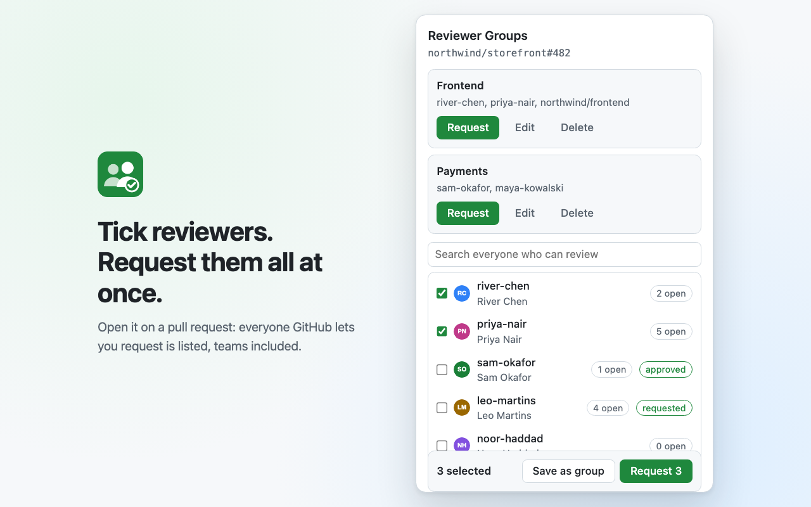
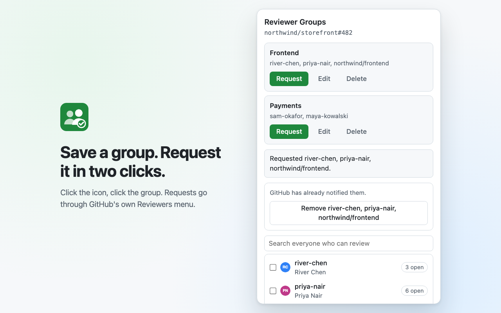
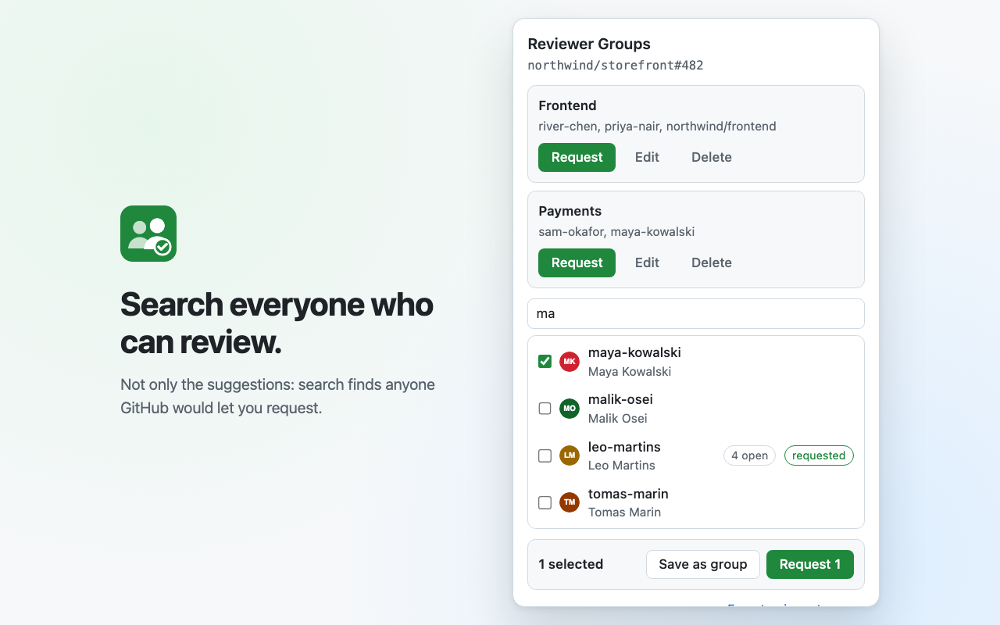

# Reviewer Groups

A Chrome extension for requesting GitHub pull request reviews from several people at once. Open it on any tab of a pull request, tick people, and request them. Save a set you use often as a group, and next time it is two clicks: the toolbar icon, then the group.

A group can be linked to repositories, so it is listed first on their pull requests, and it can ask only some of its members, picking those with the fewest open review requests. After a new push, one click re-requests everyone who already reviewed. Groups export to a file and import from one.

No token, no setup: it works with the GitHub session you are already signed in with.



## How it works

The extension uses the github.com pages and endpoints that GitHub's own Reviewers box and search use, from inside the pull request tab, with your signed-in session.

- **Listing people.** `GET <pull request>/review-requests?typeAhead=true&q=<search>` with `X-Requested-With: XMLHttpRequest` answers JSON: each person or team's id, login, name, avatar, whether they are already requested (`selected`) and whether they can review (`disabled`). An empty search returns GitHub's suggestions plus everyone currently requested; a search reaches anyone GitHub would let you request. This works on every tab of a pull request.
- **Any tab of a pull request.** The Reviewers form lives on the Conversation tab. On another tab (Files, Commits, Checks) the extension fetches the pull request's Conversation page, reads the form, its token and the Reviewers box from it, and keeps that copy until the popup closes or something changes, then fetches it again. Only a Reviewers box on the open page is ever replaced. A signed-out page, a signed-in account that cannot request reviewers, and a page the extension cannot read each get their own message.
- **Requesting.** The Reviewers box is a form that sets the whole reviewer list at once: `POST <pull request>/review-requests` with the form's `authenticity_token` and hidden fields plus one `reviewer_user_ids[]` or `reviewer_team_ids[]` per reviewer. For each member the extension first looks up their exact login, which sorts out who is already requested, unavailable or not offered, without sending anything. It then sends the form with everyone GitHub currently lists as requested plus the new people. The current reviewers always come from the JSON answer, read again just before each post, never from the page's form, because the page's copy goes stale after any change made outside it. Only one change runs at a time in a tab, and each finds the form again.
- **After requesting.** GitHub answers with fresh HTML for the Reviewers box, which the extension swaps into the page when it is open there, and the extension asks the JSON endpoint again to confirm who is now requested. Anyone not confirmed is reported as such.
- **Logins that no longer exist.** When a member is not a reviewer option on the pull request, the extension asks for their profile page (`HEAD /<login>`, `/orgs/<org>/teams/<slug>` for a team, `/apps/<name>` for a bot). A 404 means the account was renamed or removed: the result says so, the group card marks the member, and one click removes them from the group. A team you cannot see also answers 404, so the wording is "no longer on GitHub" rather than "deleted". The mark clears as soon as GitHub lists that login again.
- **Reviews already left.** The JSON answer only says who is requested; once someone submits a review, GitHub counts their request as done. The extension reads each reviewer row's tooltip in the Reviewers box ("approved these changes", "requested changes", "left review comments") and shows it as a badge, so someone who already reviewed is told apart from someone never asked.
- **Re-requesting after a push.** The popup lists everyone in the Reviewers box who left a review and is not requested again, and offers "Re-request N who reviewed". People who approved are left out unless their box is ticked. They go out in one ordinary request: someone who reviewed is no longer `selected`, so sending their id requests them again.
- **Groups linked to repositories.** A group can carry `owner/repo` or `owner/*` patterns (letters, digits, `.`, `_` and `-`; `*` only as the whole repository part; any letter case). On a pull request in a matching repository the group is listed first and marked "This repository". A pattern that is not valid is dropped when the group loads; the group stays.
- **Asking some of a group.** A group can ask a set number of its members. The members already requested count toward that number. The rest are picked from members who are available, are not the pull request's author and have not reviewed it yet, ordered by fewest open review requests, people whose count is unknown after the others, and ties going to whoever was asked least recently. If GitHub does not confirm a pick, the next member is asked. The result names who was picked with their counts, and says when fewer could be asked. A number at or above the member count asks everyone.
- **Open review requests.** `GET /search?type=pullrequests&q=is:pr is:open review-requested:<login> archived:false` with `Accept: application/json` answers JSON whose `payload.blackbirdSearchRoute.result_count` is the number of open pull requests waiting on that person's review. Counts are fetched for people only (not teams or bots), one at a time, for at most ten people shown on the open pull request and for the members of a group being asked, which go first. They are kept for ten minutes and raised by one when the extension requests that person. A 429 answer pauses counts until the popup closes. Anything else unexpected shows "Counts unavailable".
- **Removing the people just requested.** After a request that added people, the popup offers "Remove" with their names until it closes. It removes only those still requested on that same pull request, and says who was removed. GitHub has already sent its notifications by then, so this is not an undo.
- **Export and import.** The options page writes every group, with its repositories and how many it asks, to `groups.json` (`{ "version": 1, "groups": [...] }`) and reads such a file back. A file from a newer version is refused. A group whose name and members match a saved one is skipped, and the page reports how many groups were stored and how many skipped.
- **First run.** With no groups saved, the popup explains the flow. On a pull request it ticks the people and teams already requested there, bots aside, so "Save as group" keeps them.
- **Remembering people.** Everyone GitHub lists as a reviewer is remembered in `chrome.storage.local` (login, name, avatar address, person or team), on this computer only. Away from a pull request, creating or editing a group uses that list, filtered as you type.
- **Search.** GitHub's search answer always includes everyone already requested, matching or not. The popup drops those that do not match what you typed and ranks the rest: logins that start with the search, then names with a word that starts with it, then other matches.
- **Storage.** Each group lives under its own key in `chrome.storage.sync` (a name and a list of logins or `org/team` slugs), with a separate key for their order, so no single item approaches Chrome's per-item limit. A group's repositories and how many it asks live under a separate `groupOptions:<id>` key, which version 1.0.0 leaves alone when it saves, so a device still on 1.0.0 does not strip them. A stored group that cannot be read stays in storage when the others are saved. Before writing, a save checks Chrome's sync limits and refuses with a reason instead of writing part of the change. Ticks in progress live in `chrome.storage.session`, so closing the popup by clicking the page loses nothing; they clear when Chrome quits. Open request counts also live there. When each person was last asked lives in `chrome.storage.local`, on this computer only.
- **After an update.** A tab can still hold the previous version's script, which Chrome cuts off from the extension. The script marks the tab as listening per version, so the new version's script starts listening alongside it.
- **Permissions.** `storage`, `activeTab` and `scripting`. With `activeTab` the extension reaches a tab only after you click its icon, and only that tab, so it has no standing access to github.com or any other site. The options page needs no permission.

## Develop

```bash
pnpm install
pnpm build          # writes the loadable extension to dist/
pnpm dev            # rebuilds on change
pnpm check          # prettier, eslint, tsc, vitest
pnpm package        # dist/ zipped for the Chrome Web Store
pnpm screenshots    # regenerates docs/screenshots with invented people (needs Google Chrome)
```

Load it: open `chrome://extensions`, turn on Developer mode, click **Load unpacked**, and pick the `dist/` folder.

## Limits

- These endpoints and pages are GitHub internals, not a public API, and can change without notice. Everything that touches them is in `src/content/` (`githubReviewers.ts`, `conversationPage.ts`, `openRequests.ts`); `src/content/testing/fakeGitHub.ts` is the behaviour the tests assume.
- Review states are read from the English tooltips in GitHub's Reviewers box.
- Re-requesting someone who reviewed by sending their id as an ordinary reviewer has not yet been checked against a live pull request. Anyone GitHub does not show as requested afterwards is reported as not confirmed.
- The pull request's author is read from the first author link in the Conversation timeline (`.js-discussion a.author`). GitHub's reviewer list does not offer the author either, so when the link is not found the author still cannot be picked.
- Open request counts cover only pull requests you can see. When each person was last asked is kept per device, and two tabs asking at once can pick the same person.

## Screenshots

|                                                          |                                                                   |
| -------------------------------------------------------- | ----------------------------------------------------------------- |
|  |  |
