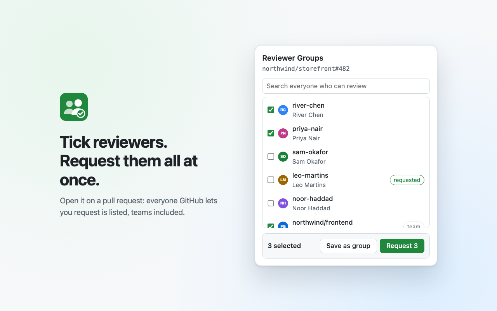
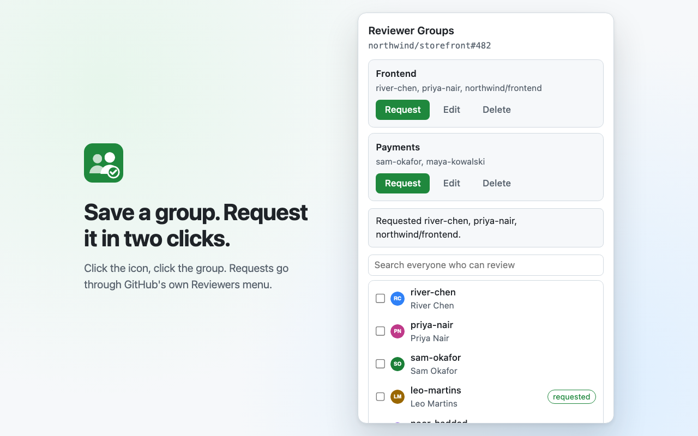
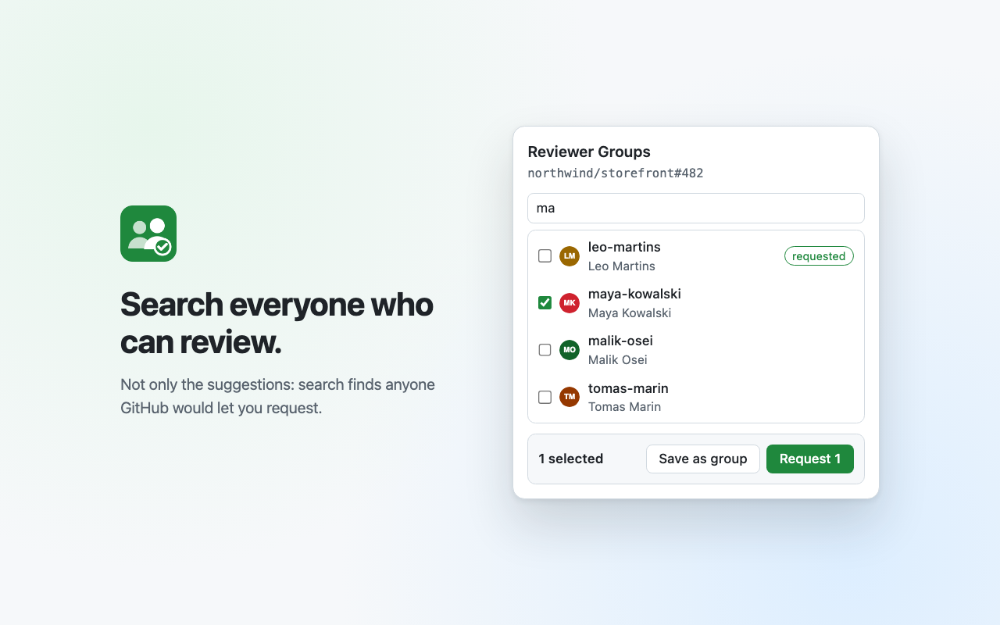

# Reviewer Groups

A Chrome extension for requesting GitHub pull request reviews from several people at once. Open it on a pull request, tick people, and request them. Save a set you use often as a group, and next time it is two clicks: the toolbar icon, then the group.

No token, no setup: it works with the GitHub session you are already signed in with.



## How it works

The extension talks to the same two github.com endpoints GitHub's own Reviewers box uses, from inside the pull request tab, with your signed-in session.

- **Listing people.** `GET <pull request>/review-requests?typeAhead=true&q=<search>` with `X-Requested-With: XMLHttpRequest` answers JSON: each person or team's id, login, name, avatar, whether they are already requested (`selected`) and whether they can review (`disabled`). An empty search returns GitHub's suggestions plus everyone currently requested; a search reaches anyone GitHub would let you request. This works on every tab of a pull request.
- **Requesting.** The Reviewers box is a form that sets the whole reviewer list at once: `POST <pull request>/review-requests` with the form's `authenticity_token` and hidden fields plus one `reviewer_user_ids[]` or `reviewer_team_ids[]` per reviewer. For each member the extension first looks up their exact login, which sorts out who is already requested, unavailable or not offered, without sending anything. It then sends the form with everyone GitHub currently lists as requested plus the new people. The current reviewers always come from the JSON answer, never from the page's form, because the page's copy goes stale after any change made outside it.
- **After requesting.** GitHub answers with fresh HTML for the Reviewers box, which the extension swaps into the page, and the extension asks the JSON endpoint again to confirm who is now requested. Anyone not confirmed is reported as such.
- **Logins that no longer exist.** When a member is not a reviewer option on the pull request, the extension asks for their profile page (`HEAD /<login>`, `/orgs/<org>/teams/<slug>` for a team, `/apps/<name>` for a bot). A 404 means the account was renamed or removed: the result says so, the group card marks the member, and one click removes them from the group. A team you cannot see also answers 404, so the wording is "no longer on GitHub" rather than "deleted". The mark clears as soon as GitHub lists that login again.
- **Reviews already left.** The JSON answer only says who is requested; once someone submits a review, GitHub counts their request as done. On the Conversation tab the extension reads each reviewer row's tooltip in the Reviewers box ("approved these changes", "requested changes", "left review comments") and shows it as a badge, so someone who already reviewed is told apart from someone never asked. Requesting that person again re-requests their review.
- **Remembering people.** Everyone GitHub lists as a reviewer is remembered in `chrome.storage.local` (login, name, avatar address, person or team), on this computer only. Away from a pull request, creating or editing a group uses that list, filtered as you type.
- **Search.** GitHub's search answer always includes everyone already requested, matching or not. The popup drops those that do not match what you typed and ranks the rest: logins that start with the search, then names with a word that starts with it, then other matches.
- **Storage.** Each group lives under its own key in `chrome.storage.sync` (a name and a list of logins or `org/team` slugs), with a separate key for their order, so no single item approaches Chrome's per-item limit. Ticks in progress live in `chrome.storage.session`, so closing the popup by clicking the page loses nothing; they clear when Chrome quits.
- **Permissions.** `storage`, `activeTab` and `scripting`. With `activeTab` the extension reaches a tab only after you click its icon, and only that tab, so it has no standing access to github.com or any other site.

## Develop

```bash
pnpm install
pnpm build          # writes the loadable extension to dist/
pnpm dev            # rebuilds on change
pnpm check          # prettier, eslint, tsc, vitest
pnpm package        # dist/ zipped for the Chrome Web Store
pnpm screenshots    # regenerates docs/screenshots with invented people (needs Google Chrome)
```

Load it: open `chrome://extensions`, turn on Developer mode, click **Load unpacked**, and pick the `dist/` folder.

## Release

Merging to `main` keeps a release pull request open: [release-please](https://github.com/googleapis/release-please) bumps the version in `package.json` and `manifest.json` and writes `CHANGELOG.md` from the Conventional Commit titles. Merging that pull request tags `vX.Y.Z` and publishes the GitHub release, which starts `.github/workflows/publish.yml`: it checks the tag against `manifest.json`, runs `pnpm check`, attaches `reviewer-groups-X.Y.Z.zip` to the release, and uploads the same zip to the Chrome Web Store and submits it for review. Google publishes it once the review passes.

The publish job needs, in the repository settings:

| Name                                                      | Kind      | What it is                                                                                                                                                                                                                                               |
| --------------------------------------------------------- | --------- | -------------------------------------------------------------------------------------------------------------------------------------------------------------------------------------------------------------------------------------------------------- |
| `RELEASE_APP_ID`, `RELEASE_APP_PRIVATE_KEY`               | secrets   | A GitHub App installed on this repository, so the release pull request it opens runs CI and the release it publishes starts the publish workflow                                                                                                         |
| `CWS_CLIENT_ID`, `CWS_CLIENT_SECRET`, `CWS_REFRESH_TOKEN` | secrets   | A Google OAuth client with the Chrome Web Store API enabled, and a refresh token for the store's developer account; the OAuth app's publishing status must be "In production", since a refresh token from an app in "Testing" stops working after 7 days |
| `CWS_EXTENSION_ID`, `CWS_PUBLISHER_ID`                    | variables | The store item's ID, and the developer account's publisher ID from the dashboard's Account page                                                                                                                                                          |

When a step fails, re-run the publish job, or start it by hand from the Actions tab with the release tag. Store screenshots, the promo tile and the listing text are not part of the package; they change only in the developer dashboard, from `docs/store-listing.md` and `docs/screenshots/`.

## Limits

- Both endpoints are GitHub internals, not a public API, and can change without notice. Everything that touches them is in `src/content/githubReviewers.ts`; `src/content/testing/fakeGitHub.ts` is the behaviour the tests assume.
- Requesting needs the pull request's Conversation tab, where the Reviewers form and its token live. Listing and building groups work on any tab of a pull request.

## Screenshots

|                                                          |                                                                   |
| -------------------------------------------------------- | ----------------------------------------------------------------- |
|  |  |
